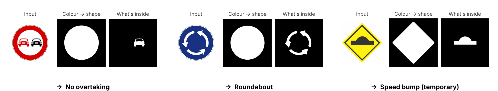
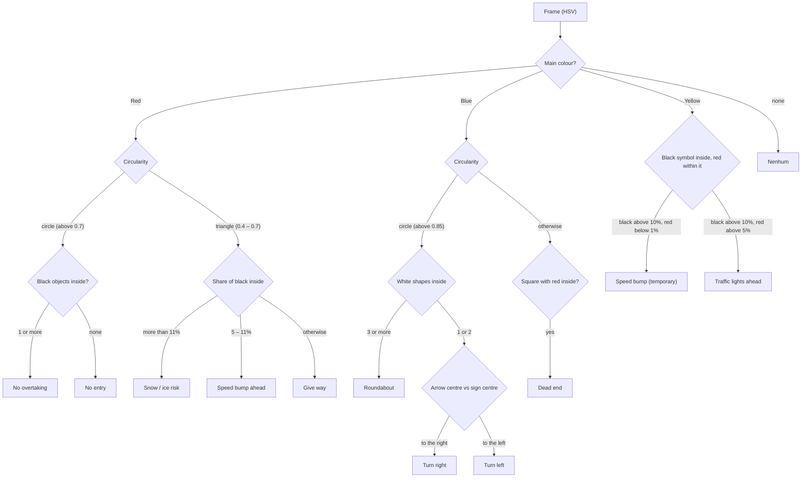
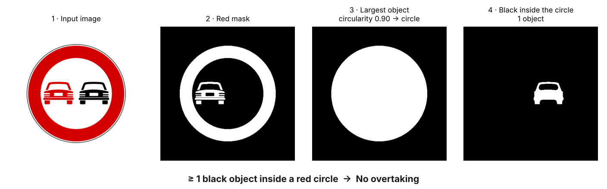
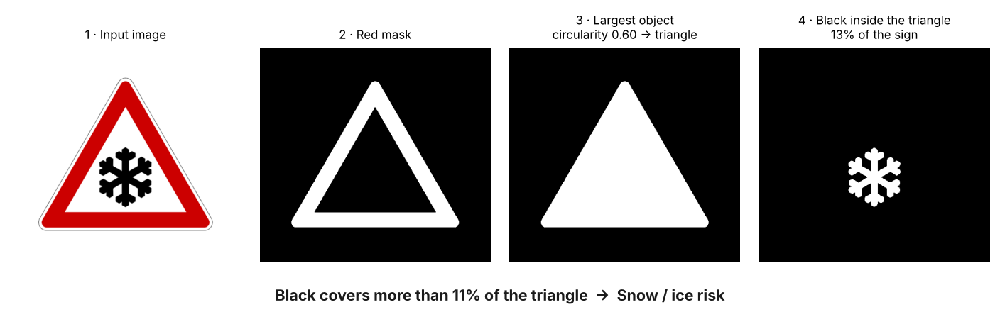
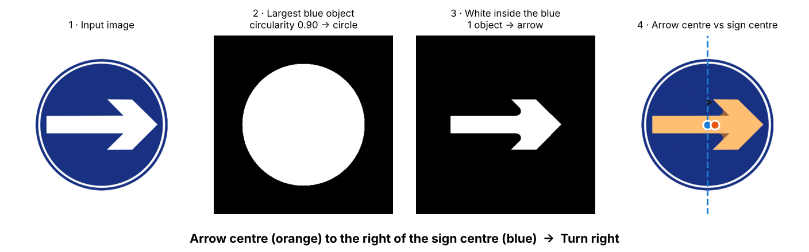
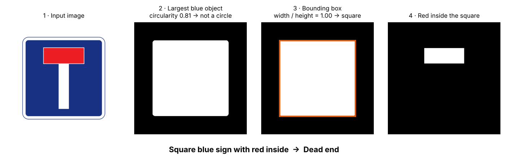
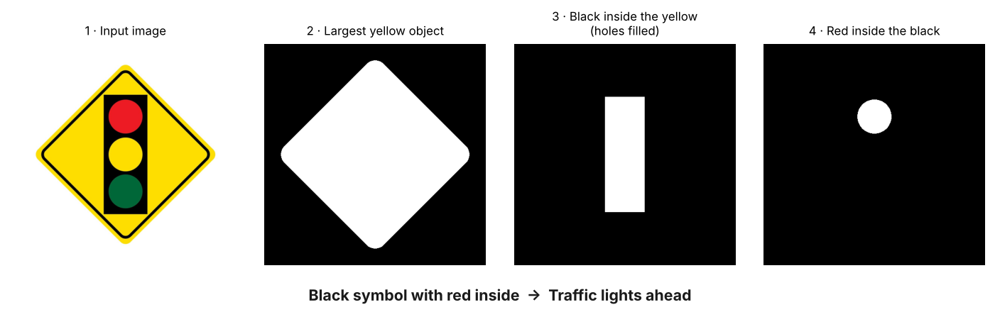

# Real-Time Traffic Sign Recognition (MATLAB)

A MATLAB app that watches a **webcam** and recognizes **11 traffic signs in real time**. It doesn't use machine learning: each sign is identified by a chain of simple image-processing rules. First the **colour** tells which family the sign belongs to, then the **shape** narrows it down, and finally **what is drawn inside** names the exact sign.

The app also lets the user **calibrate the colours on the spot**, **look at every intermediate step**, **validate each result by hand** and follow the system's **accuracy, precision and recall** over time.

<p align="center">
  <br>
  <em>The idea in three steps: colour, then shape, then what's inside</em>
</p>

---

## Repository structure

```
.
├── app.mlapp                   # the app: interface and image processing
├── History.mat                 # history and metrics
├── signs/                      # reference images of the 11 recognized signs
├── images/                     # figures used in this README
└── README.md
```

---

## Recognized signs

<div align="center">

<table>
  <tr>
    <th colspan="5" align="center">Red</th>
  </tr>
  <tr>
    <td align="center"></td>
    <td align="center"></td>
    <td align="center"></td>
    <td align="center"></td>
    <td align="center"></td>
  </tr>
  <tr>
    <td align="center">No entry</td>
    <td align="center">No overtaking</td>
    <td align="center">Give way</td>
    <td align="center">Speed bump ahead</td>
    <td align="center">Snow / ice risk</td>
  </tr>
</table>

<br>

<table>
  <tr>
    <th colspan="4" align="center">Blue</th>
  </tr>
  <tr>
    <td align="center"></td>
    <td align="center"></td>
    <td align="center"></td>
    <td align="center"></td>
  </tr>
  <tr>
    <td align="center">Turn right</td>
    <td align="center">Turn left</td>
    <td align="center">Roundabout</td>
    <td align="center">Dead end</td>
  </tr>
</table>

<br>

<table>
  <tr>
    <th colspan="2" align="center">Yellow</th>
  </tr>
  <tr>
    <td align="center"></td>
    <td align="center"></td>
  </tr>
  <tr>
    <td align="center">Speed bump (temporary)</td>
    <td align="center">Traffic lights ahead (temporary)</td>
  </tr>
</table>

</div>

When none of them is in view, the app shows **"Nenhum"** (none).

---

## Using the app

<p align="center">
  <br>
  <em>Main screen: live video on the left, processed mask on the right, HSV parameters and validation below</em>
</p>

1. Open `app.mlapp` in MATLAB and run it.
2. Press **Connect**. The webcam starts and the live image appears under *Original*.
3. Calibrate each colour: press **Calibrate Red**, **Blue** or **Yellow** and click **5 points** of that colour on the image. The HSV ranges are filled in automatically, and can also be typed by hand and applied with **Manually Input HSV Values**.
4. Press **Start Processing**. The mask of the detected sign appears under *Processed* and its name under *Signal Detected*.
5. To check a result, press **Pause**, then **Correct** or **Incorrect**. If it was incorrect, choose the real sign from the list and press **Save**.
6. Use the **Menu** to open the **History** panel or the debug panels for **Red**, **Blue** and **Yellow**.

### Requirements

- MATLAB with **App Designer**
- **Image Processing Toolbox**
- **Image Acquisition Toolbox** with the **OS Generic Video Interface** support package (`winvideo`, so the app runs on **Windows**)
- A webcam

---

## How it works

A timer grabs a frame from the webcam **20 times per second** and sends it through the steps below.

### 1. From RGB to HSV

In **RGB**, colour and brightness are mixed together: a shadow changes all three channels, and "red" stops looking like red. In **HSV**, the colour lives in the **Hue** channel and the brightness in the **Value** channel. A shadow mostly changes the Value, so the colour can still be found. The Value channel is also **equalized** to stretch the webcam's weak contrast.

### 2. One mask per colour

Each pixel is tested against an HSV range, which gives one black-and-white mask per colour:

- **Red, blue and yellow** use the ranges calibrated in the app.
- **Black** (very dark) and **white** (bright and with little colour) use fixed ranges, because they are mostly defined by brightness.

The app then **counts the pixels** of each colour. If there are enough red, blue or yellow pixels in the frame, the sign belongs to that family. The colours are checked in that order: red, then blue, then yellow.

### 3. Isolate the sign

The background can have small spots of the same colour, so only the **largest connected object** is kept. Morphological operations clean it up:

- **Fill** closes the holes left by the drawing inside the sign, so the sign becomes one solid shape.
- **Close** and **dilate** join parts that were split by reflections or small gaps.
- **Erode** and **open** remove thin borders and isolated noise.

### 4. Shape and content: the decision tree

Once the sign is isolated, its **shape** and the **masks of the colours inside it** decide which sign it is:



**Circularity** measures how close a shape is to a circle: about 1 for a circle, lower for a triangle or a square. It is computed from the shape's area and perimeter.

The figures below show each branch step by step.

#### Red signs: circle or triangle

For a red **circle**, the app looks for **black objects** inside it. The *No overtaking* sign has a black car, while *No entry* is empty inside. The red car in *No overtaking* doesn't count, because it is red, not black.

<p align="center"></p>

For a red **triangle**, the app measures **how much of the triangle is black**. The snowflake covers a lot of it, the speed bump a little, and *Give way* has nothing inside.

<p align="center"></p>

#### Blue signs: arrows, roundabout and dead end

On a blue **circle**, the white shapes inside give the answer. The roundabout has **3 arrows**. A single arrow has **more of its area on the side its head points to**, so comparing the **horizontal centre of the white arrow** with the **centre of the blue sign** tells right from left.

<p align="center"></p>

If the blue shape isn't a circle, the **bounding box** checks whether it is a **square** (width about equal to height), and a **red bar inside** confirms the *Dead end* sign.

<p align="center"></p>

#### Yellow signs: what's inside the black symbol

Both yellow signs have a black symbol. The app fills the holes in the black mask, so the coloured lights of the traffic light become part of the symbol, and then looks for **red inside the black**. Red means *Traffic lights ahead*, and no red means *Speed bump*.

<p align="center"></p>

### 5. Colour calibration

Lighting changes from room to room and through the day, so fixed colour ranges kept failing. Instead, the user **clicks 5 points** of a colour on the live image, and the app builds the range from them:

- **Hue:** from the lowest to the highest value clicked, plus a margin of **±0.08** on each side (wrapping around for red, which sits at both ends of the hue scale).
- **Saturation and Value:** from the lowest value clicked minus **0.15**, up to the maximum.

The margin accepts the shades of the sign that weren't exactly clicked, and the values can still be fine-tuned by hand.

### 6. Debug panels

Each colour has its own panel showing **every intermediate mask** (largest object, black/white/red inside) and **every number used in the decision**: circularity, object counts, pixel counts and proportions, and the centres of the arrow and the sign. This made it possible to tune the rules by looking at what the algorithm actually sees.

### 7. Validation and metrics

Pressing **Pause** freezes the processing so the result can be checked:

- **Correct:** the result is saved as right.
- **Incorrect:** the user picks the real sign from a list, and the result is saved as wrong.

Each record goes to `History.mat` with the detected sign, the real sign, the verdict, all the HSV ranges in use, and the date and time. From these records the **History** panel classifies every sample as a true or false positive or negative and plots, over time:

- **Accuracy:** how often the system is right overall, including correctly seeing *no sign*.
- **Precision:** when the system names a sign, how often that sign is right.
- **Recall:** of all the signs shown, how many the system found.

---

## Key points

- **No machine learning:** every sign is recognized with interpretable rules on colour, shape and content, so it's always clear *why* a sign was chosen.
- **HSV with brightness equalization**, for colour detection that copes with shadows and different lighting.
- **Rule-based classification** with circularity, bounding box, object counts, area proportions and centroids.
- **In-app calibration** by clicking on the image, so the system adapts to the lighting without changing the code.
- **Transparent debugging:** dedicated panels show every mask and value behind each decision.
- **Built-in evaluation:** manual validation, a saved history and live accuracy, precision and recall.

---

## Notes

- **Lighting** is the biggest challenge. Recalibrating the colours on site makes a big difference.
- The step-by-step figures in *How it works* reproduce the app's processing on the reference sign images, so that each step can be seen clearly. With a real camera the masks are noisier, which is what the morphological cleaning is for.
- The interface labels are in English, and the sign names and some messages are in Portuguese.

---

## Author

**Ivo Azevedo**
