# Real-Time Traffic Sign Recognition (MATLAB)

A MATLAB app that recognizes **traffic signs in real time from a webcam**. It finds the sign by its **colour**, works out its **shape**, looks at **what is drawn inside it**, and names the sign. The app also lets the user calibrate the colours on the spot, check each result by hand, and follow the system's accuracy over time.

Built with **MATLAB App Designer**, using the Image Processing and Image Acquisition toolboxes.

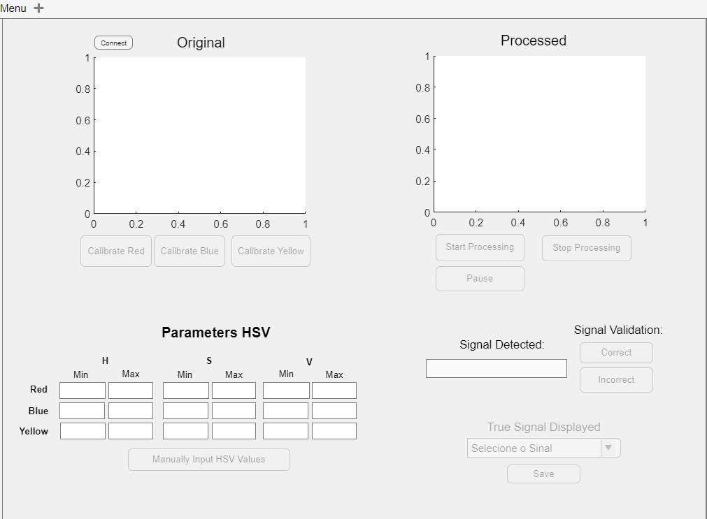

> Project developed for the course **Robotics**, BSc in **Electrical and Computer Engineering**, **Instituto Politécnico do Cávado e Ave (IPCA)**, **3rd year**.

---

## Repository structure

```
.
├── app.mlapp               # the app (interface + processing)
├── signs/                  # images of the 11 recognized signs
├── images/                 # screenshots and block diagrams
└── README.md
```

---

## Recognized signs

The app knows **11 Portuguese traffic signs**, grouped by their main colour:

| Red | | | | |
|:---:|:---:|:---:|:---:|:---:|
| 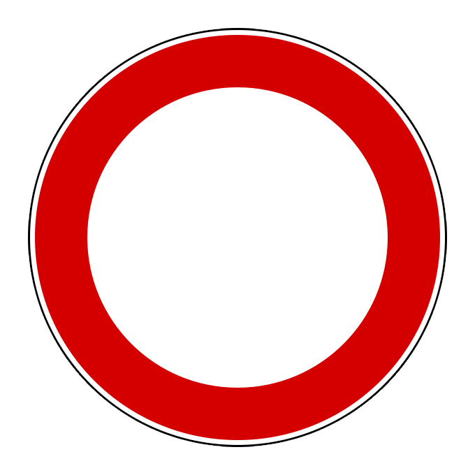 | 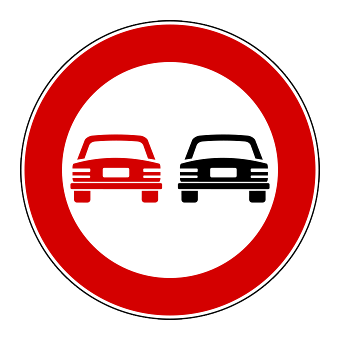 | 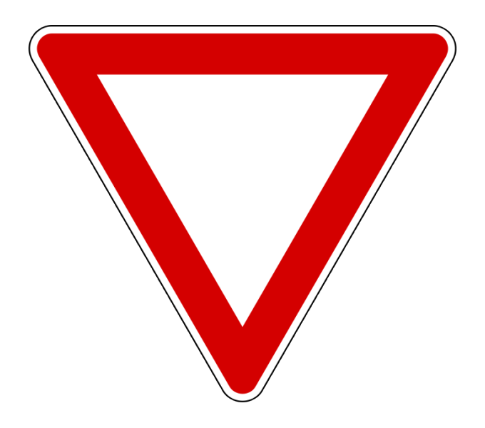 | 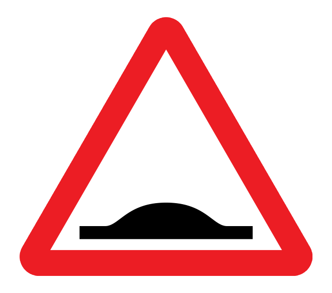 | 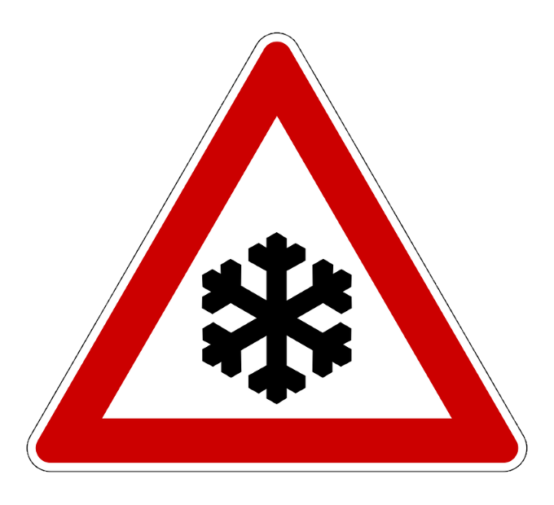 |
| No entry | No overtaking | Give way | Speed bump ahead | Snow / ice risk |

| Blue | | | |
|:---:|:---:|:---:|:---:|
| 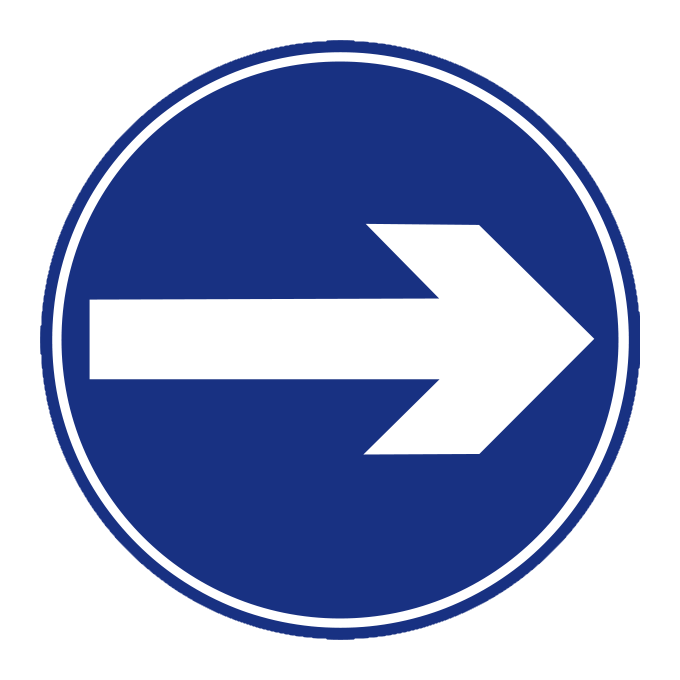 | 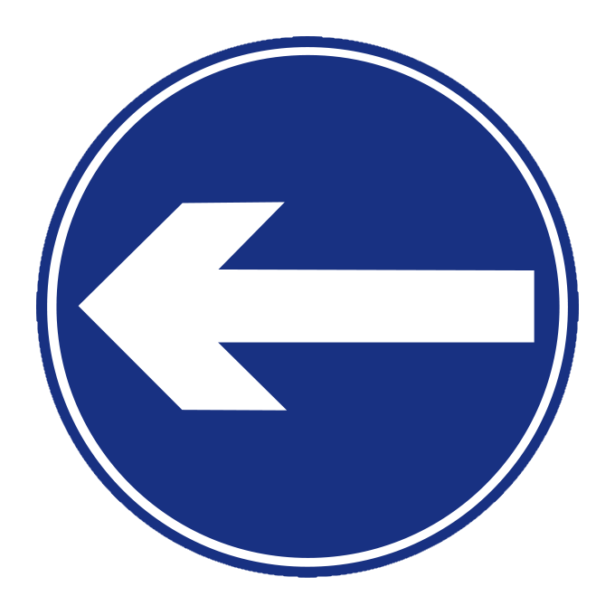 | 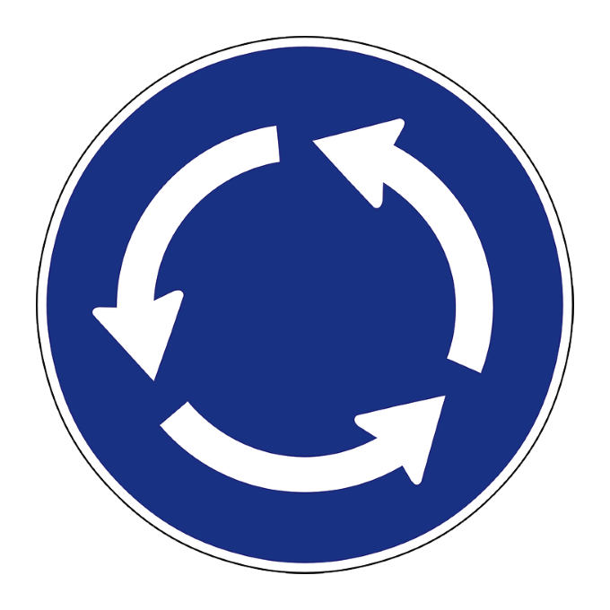 | 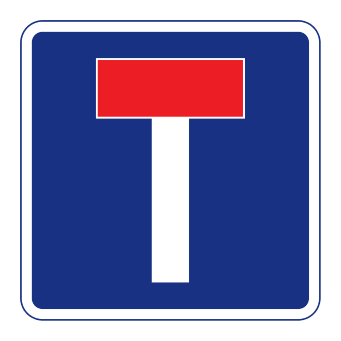 |
| Turn right | Turn left | Roundabout | Dead end |

| Yellow | |
|:---:|:---:|
| 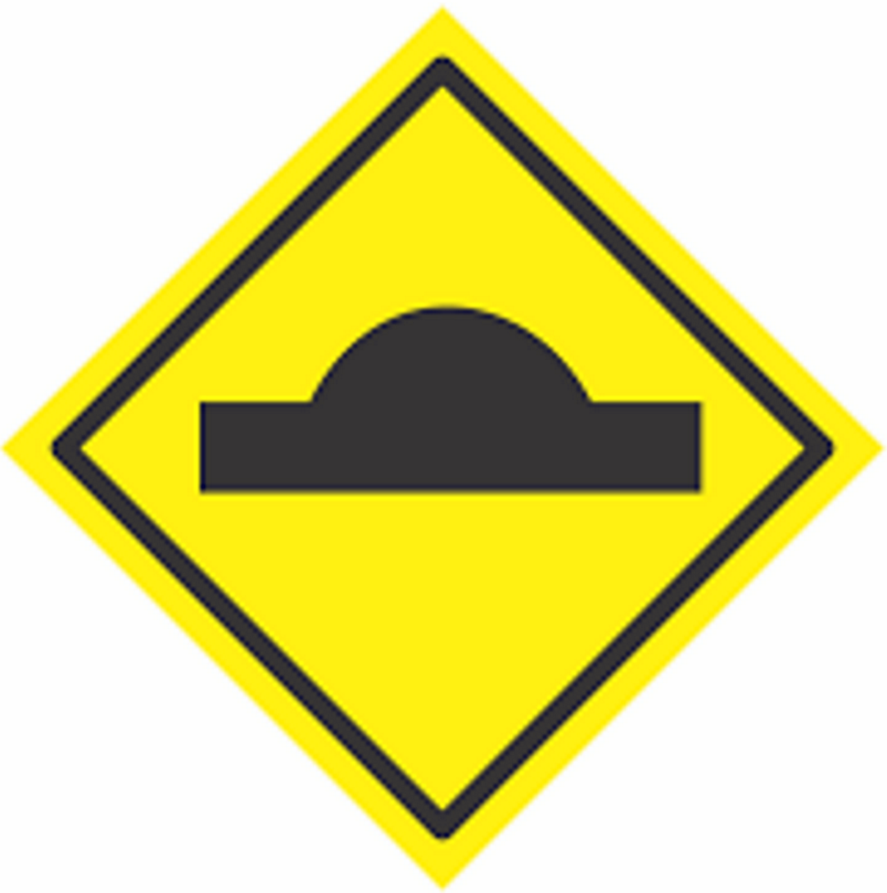 | 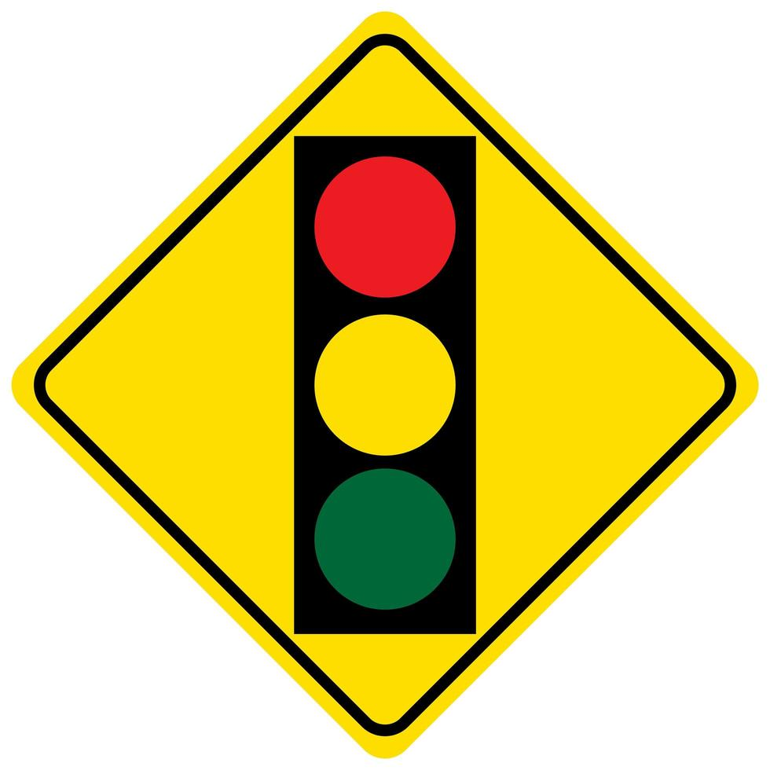 |
| Speed bump (temporary) | Traffic lights ahead (temporary) |

When none of them is in view, the app shows **"Nenhum"** (none).

---

## Using the app

1. Open `app_TP1_25547_15526.mlapp` in MATLAB and run it.
2. Press **Connect** to start the webcam.
3. Calibrate the colours with **Calibrate Red / Blue / Yellow**, or type the HSV values and press **Manually Input HSV Values**.
4. Press **Start Processing**. The processed image and the detected sign appear on the right.
5. Press **Pause** to validate a result with **Correct** or **Incorrect**.
6. Open **Menu → History** to see the saved results and the metrics, or the colour panels to look at the intermediate steps.

### Requirements

- MATLAB with **App Designer**
- **Image Processing Toolbox**
- **Image Acquisition Toolbox** with the **OS Generic Video Interface** support package (`winvideo`, so it runs on **Windows**)
- A webcam

---

## How it works

Every frame from the webcam (20 per second) goes through the same steps:

1. **Colour space.** The image is converted from RGB to **HSV**, which separates the colour (hue) from the brightness. A shadow then changes the brightness but not the colour, so the detection is much less sensitive to lighting. The brightness channel is also equalized, to make up for the webcam's weak contrast.
2. **Colour masks.** One black-and-white mask is made for each colour: red, blue and yellow (calibrated by the user), and black and white (fixed).
3. **Which colour?** The app counts the pixels of each colour. If there are enough red, blue or yellow pixels, the sign belongs to that group.
4. **Isolate the sign.** Only the **biggest object** of that colour is kept, so small spots in the background are ignored. Morphological operations (erode, dilate, open, close and fill) clean the mask and close gaps.
5. **Shape.** The **circularity** of the object tells circles from triangles. For blue signs that aren't round, the **bounding box** checks whether the shape is a square.
6. **What's inside.** The app makes new masks for the colours *inside* the sign (black inside red, white inside blue, black and red inside yellow), then counts the objects and the share of the sign each colour covers.
7. **Decision.** These features identify the sign. For example:
   - a red **circle** with something black inside is *No overtaking*, and an empty one is *No entry*;
   - a red **triangle** is told apart by how much of it is black: a lot is *Snow*, a little is *Speed bump*, none is *Give way*;
   - on a blue circle, **3 or more white shapes** mean *Roundabout*. Otherwise the **position of the arrow's centre** compared to the sign's centre tells *right* from *left*;
   - a blue **square** with red inside is *Dead end*;
   - on yellow signs, the **red** inside the black symbol separates *Traffic lights* from *Speed bump*.

The full decision logic:

<p align="center">
  
  
</p>

---

## Key points

- **Real-time:** frames are captured and classified continuously from the webcam.
- **Colour calibration in the app:** after pressing *Calibrate Red/Blue/Yellow*, the user clicks **5 points** of that colour on the live image. The app reads their HSV values and adds a safety margin, so similar shades are still accepted. The values can also be typed in by hand. This avoids changing the code whenever the lighting changes.
- **Debug panels:** one panel per colour shows the intermediate masks (biggest object, black/white/red inside) and the values used to decide (circularity, object counts, proportions, centres).
- **Manual validation:** *Pause* freezes the processing so the user can mark the result as **Correct** or **Incorrect**. When it is incorrect, the user picks the real sign from a list.
- **History and metrics:** every validation is saved to `History.mat` (detected sign, real sign, result, HSV thresholds, date and time). The history panel shows them in a table, with a correct/incorrect bar chart and the **accuracy, precision and recall** over time.

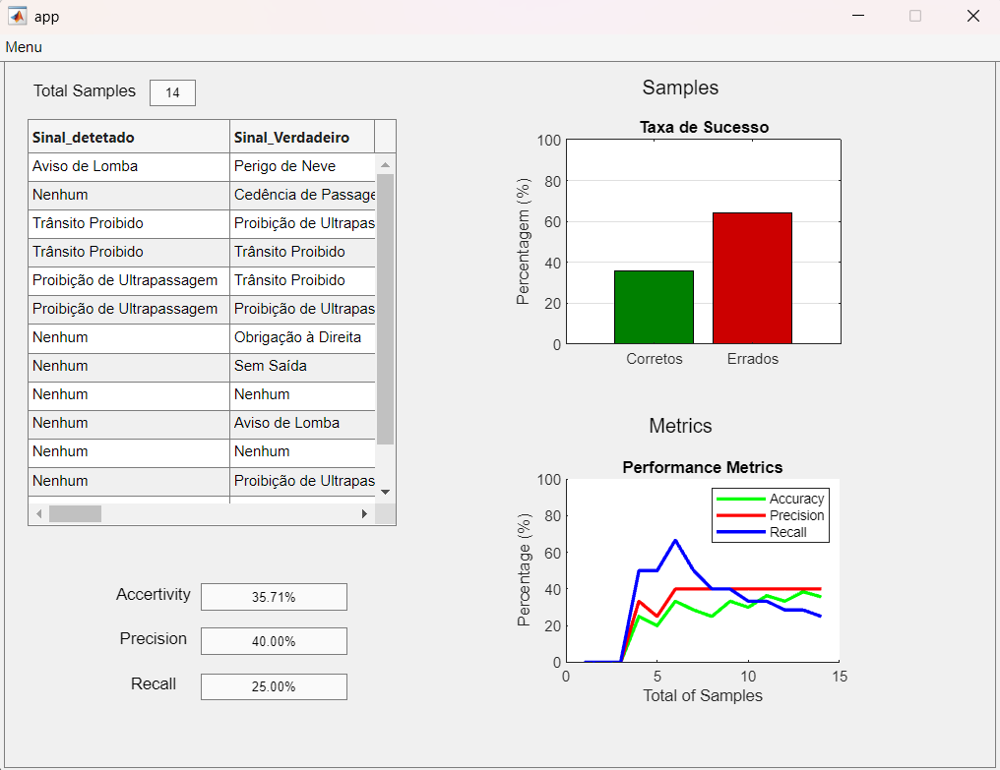

---

## Notes

- Lighting is the biggest challenge. Recalibrating the colours on site makes a big difference.
- The labels and messages in the app are in Portuguese.

---

## Author

**Ivo Azevedo**
